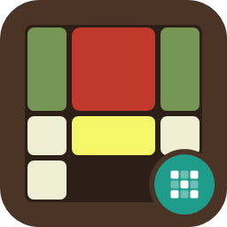

# E2e4.SlidingBlock.Logic



A small sliding block puzzle engine for .NET: bitboard-driven state structs with allocation-free move generation, and generic
solvers, for the N-puzzle, Klotski, Rush Hour, Soko-style pushing and general polyominoes. It targets `net10.0`, `net8.0` and `netstandard2.0`, so it runs on every current .NET on Windows, Linux and macOS, and through the `netstandard2.0` build on .NET Framework 4.6.1 and later, Mono and Unity. The `net10.0` and `net8.0` builds have no dependencies; `netstandard2.0` depends on `System.Memory` for `Span<T>`. Install from NuGet:
`E2e4.SlidingBlock.Logic`.

Every puzzle is an `ISlidingBlockDomain<TState, TMove>` (initial state, goal test, move generation, move application and a 64-bit state hash),
and `PuzzleSolver` solves any of them with BFS, A* or IDA*.

```csharp
// The engine does not know where the blank belongs: the puzzle supplies its goal position.
var goal = new NPuzzleState(0xFEDCBA9876543210UL);
var domain = new NPuzzleDomain(goal, goal);
var start = PuzzleWalk.RandomWalk(domain, goal, 25, new Random(3));

SolveResult<NPuzzleMove> result = new PuzzleSolver().SolveIdaStar(domain, start, domain.ManhattanDistance);
Console.WriteLine(result.IsSolved ? result.Moves.Count : -1);

// Rush Hour: the vehicles are read off a diagram (using E2e4.SlidingBlock.Logic.Text), the red car X is vehicle 0 and has to reach
// the far end of its row (offset 4 for a car two cells long); a move slides a vehicle one cell.
string[] diagram = ["CCH..F", "..HB.F", ".XXB..", "D..B..", "DGG...", "..EEE."];
var vehicles = LaneDiagram.Parse(diagram, LaneDiagram.SymbolsOf(diagram, leadingLabels: "X"));
var rushHour = new LaneSlideDomain<LaneState16, Bitboard64>(vehicles, columns: 6, rows: 6, goalVehicle: 0, goalOffset: 4, maxStep: 1);
Console.WriteLine(new PuzzleSolver().SolveBfs(rushHour, rushHour.InitialState).Moves.Count);
```

## What is in it

- `NPuzzleState`: the 4x4 sliding tile puzzle packed into 16 nibbles of a `ulong`, with a branchless XOR tile swap. The goal position is a constructor argument, and the Manhattan distance is measured against it.
- `KlotskiState` and `KlotskiDomain`: Klotski with a canonical shape key, so interchangeable pieces are the same position.
- `LaneState16`, `LaneState64` and `LaneSlideDomain<TState, TBitboard>`: vehicles as lane offsets packed 4 bits each (up to 64 vehicles on 128 cells); Rush Hour moves one cell, garage puzzles slide any distance.
- `PushState` and `PushDomain`: Soko warehouse pushing, where the storeman's walking is free, with dead squares and a heuristic.
- `ShuntingTrack` and `ShuntingDomain<TBitboard>`: railway shunting (Hordern chapter J), with engines that push and pull wagons over switches, wyes and turntables, solved with `SolveDijkstra`; `ShuntingMap` reads one from text.
- `PolyominoState` and `PolyominoDomain`: non-rectangular pieces (L, T, J, S, Z, U) on a bitboard, with multi-step corner-hook slides and a
  permutation-invariant Zobrist hash.
- `PuzzleTopology` and `PuzzleTopologyBuilder`: build a board from relative cell lists, with LSB normalisation and precomputed
  valid-anchor masks.
- `E2e4.SlidingBlock.Logic.Text`: `TopologyMap`, `LaneDiagram` and `PushMap` read boards, vehicles and warehouses from diagrams (one string
  per row, with the symbols you choose). The domains themselves take plain data, so a layout can come from anywhere.
- `PuzzleSolver`: generic BFS, A* and IDA*, with a node limit and cancellation; `SolveResult.Status` says whether a search found nothing because
  the puzzle is unsolvable or because it hit the limit.
- `PuzzleWalk` and `PlaySession<TState, TMove>`: a generic random walk (for solvable shuffles) and the undo, redo and reset bookkeeping
  every interactive puzzle needs.

The engine contains no puzzle: no layouts, no goal positions, no colours. The application that uses it defines its layouts and goals and hands them to
the domains as data (`LabPuzzles` in the Labs is an example).

`E2e4.SlidingBlock.Logic.Labs.Wpf` in the repository is a WPF application with three laboratories that show the bitboards and the solvers
working. It is not part of the package.

## Documentation

The research and design notes behind the object model (representations, LSB normalisation, valid anchors and hook moves, Zobrist
hashing, with diagrams) are in [docs](https://github.com/th3snark/E2e4.SlidingBlock.Logic/blob/master/docs/README.md).

## Build and test

```
dotnet test E2e4.SlidingBlock.Logic.slnx
```

See [CONTRIBUTING.md](https://github.com/th3snark/E2e4.SlidingBlock.Logic/blob/master/CONTRIBUTING.md) to help, [CHANGELOG.md](https://github.com/th3snark/E2e4.SlidingBlock.Logic/blob/master/CHANGELOG.md) for what changed, and [SECURITY.md](https://github.com/th3snark/E2e4.SlidingBlock.Logic/blob/master/SECURITY.md) to report a vulnerability.

## Licence

MIT, see [LICENSE](https://github.com/th3snark/E2e4.SlidingBlock.Logic/blob/master/LICENSE). No dependencies.
