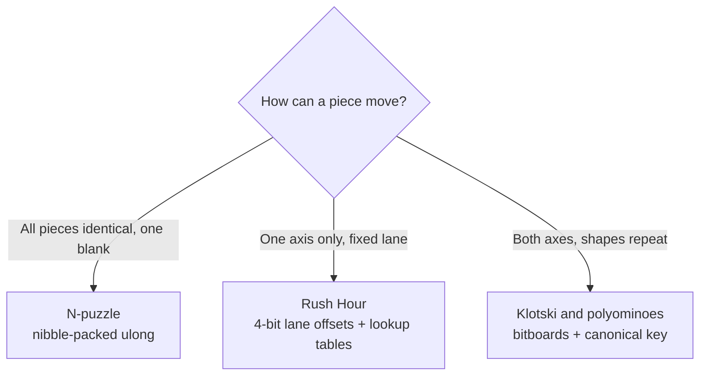

# 1. Why three representations

Sliding-block puzzles are PSPACE-complete in the general case (Hearn & Demaine, 2005). Solver throughput therefore depends on three
things: the size of a state, the branching of move generation, and the cost of hashing states for a transposition table.
Engines converge on three specialised 64-bit layouts, chosen by each piece's degrees of freedom.



## 1.1 Uniform N-puzzles: nibble-packed `ulong`

A 4x4 board holds the values `0..15`, which need 4 bits each: `16 * 4 = 64` bits, so a whole position is one CPU register.

```
square:   15 14 13 12 ... 3  2  1  0
nibble:    F  E  D  C ... 3  2  1  0      0xFEDCBA9876543210  (solved: tile k on square k, blank on 0)
```

- Sliding the tile on square `t` into the blank on square `b` is a branchless nibble XOR:
  `v' = v ^ (tile << 4b) ^ (tile << 4t)`, because the blank nibble is `0`.
- The blank is found with the has-zero-nibble trick and `tzcnt`: `tzcnt((v - 0x1111...) & ~v & 0x8888...) >> 2`.
- IDA* solvers also keep an *inverse* `ulong` (nibble `tile` holds its square) for O(1) pattern-database lookups
  (Korf & Felner, 2002). `NPuzzle4x4State.InverseMap` provides it.

## 1.2 Axis-constrained puzzles: 1D offset packing (Rush Hour)

Cars (`1x2`) and trucks (`1x3`) cannot change lane or rotate, so each vehicle has exactly one degree of freedom: its offset
`0..15` along its fixed row or column (a lane is at most 16 cells). That is 4 bits per vehicle, packed 16 to a `ulong`
(`LaneState16` holds 16 vehicles in one word, `LaneState64` holds 64 in four), so up to 64 vehicles on a board of up to 128 cells (a `Bitboard128` cell register) fit. The same `LaneSlideDomain<TState, TBitboard>` plays
classic Rush Hour (`maxStep` 1, one cell per move) and the garage puzzles (any distance is one move).

- Occupancy is rebuilt in O(N) from a precomputed table `MaskAt(vehicle, offset)`.
- Legality of a slide is that no cell it passes over or lands on is held by another vehicle: `(MaskAt(v, o) & others) == 0`
  for each offset `o` up to `maxStep` away, stopping at the first blocked one.

## 1.3 Unrestricted 2D pieces: Klotski and polyominoes

Pieces move in two dimensions and several are identical. A naive "piece id per cell" array has two problems.

1. **Symmetry explosion.** Swapping `k` identical pieces multiplies the number of states by `k!`. Standard Klotski has four identical
   vertical blocks and four identical single blocks, so `4! * 4! = 576` times more states than necessary.
2. **Non-rectangular shapes.** A `T`, `J` or `L` introduces three hazards for bounding-box bitboards:

| Hazard | Problem | Solved by |
|--------|---------|-----------|
| Empty bounding-box origin | An upward `T` (`.#. / ###`) has an empty top-left corner, so two interlocking pieces can share an origin, or an origin can lie off the board | [LSB normalisation](02-lsb-normalisation.md) |
| Asymmetric row wrap-around | A shape can overhang left on a lower row and wrap across a row boundary on a 1D bitboard | [`ValidAnchorsMask`](03-valid-anchors-and-hook-moves.md) |
| Cell-encoding overflow | Encoding a shape class per cell (3 bits x 20 cells = 60 bits) overflows 64 bits beyond 7 classes or 21 cells | Per-group anchor bitboards ([GroupAnchors](04-zobrist-and-group-anchors.md)) |

`KlotskiState` keeps the compact 60-bit canonical shape key (3 bits per cell, class `0..4`) because Klotski stays within those limits.
`PolyominoState` uses one anchor bitboard per equivalence group instead, which has no such limit.

## 1.4 Summary

| Puzzle | State | Bits | Identity of a position | Hash |
|--------|-------|------|------------------------|------|
| 15-puzzle | `NPuzzle4x4State` | 64 (16 x 4) | the `ulong` | multiplicative mix of the `ulong` |
| Rush Hour | `LaneState16` | 64 (16 x 4) | the packed offsets | multiplicative mix |
| Garages | `LaneState64` | up to 256 (64 x 4) | the packed offsets | fold of four words (`Hashing.Mix`) |
| Klotski | `KlotskiState` | 60 (20 x 3) | `CanonicalShapeKey` | multiplicative mix of the key |
| Polyominoes | `PolyominoState` | one `ulong` per group | `GroupAnchors[]` + Zobrist hash | incremental Zobrist XOR |
