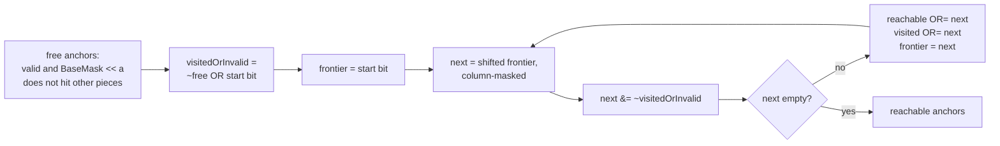

# 3. Valid anchors and hook moves

## 3.1 `ValidAnchorsMask` instead of sentinel walls

Many bitboard engines pad the board with sentinel wall columns so that shifts cannot wrap across rows. That wastes bits and does not
help with overhanging shapes. This engine precomputes, per equivalence group, a mask `ValidAnchorsMask[g]` when the topology is built:

> Bit `s` is set iff, in 2D `(row, col)` coordinates, placing every cell of the shape relative to anchor `s` stays inside
> `[0..Height-1, 0..Width-1]` and avoids static wall squares.

At run time a single bit test proves a placement is safe:

```csharp
((group.ValidAnchorsMask >> nextAnchor) & 1UL) != 0   // => group.BaseMask << nextAnchor can never wrap or hit a wall
```

### Why column 0 is forbidden for the upward T and the J

The T has a cell at `dCol = -1` on the row below the anchor. On a 5-wide board with the anchor on square `s` in column 0, that
cell would land on bit `s + 5 - 1`, which is the last column of the *same* row as the anchor, not off the board to the left. The shift
is valid arithmetic but produces a wrong shape. The 2D test rejects it:

```
anchor in column 0                     anchor in column 1 (valid)
 A . . . .                              . A . . .
 # # # . .   <- the cell at dCol=-1     # # # . .
 ^ would be column -1 -> bit wraps      ^ all cells inside the board
```

On the lab board the T's valid anchors exclude column 0 and every anchor whose footprint touches the centre wall (square 12).

## 3.2 Multi-step "hook" moves

Under the single-piece sliding metric a piece may slide several squares, including around corners, in one turn. Because a piece's
placement is identified by its single anchor bit, all single-turn destinations are found by a flood fill over *anchors*, entirely in
registers (no heap allocation):



The four neighbour shifts of the frontier are:

| Direction | Expression | Mask preventing row wrap |
|-----------|-----------|--------------------------|
| right | `frontier << 1` | `& notCol0` |
| left | `frontier >> 1` | `& notLastCol` |
| down | `frontier << W` | none (bits past the board are never free) |
| up | `frontier >> W` | none |

`PolyominoState.FindReachableAnchors(...)` takes an `AllowedDirections` argument, so horizontal-only or vertical-only pieces simply skip
the other pair of shifts.

### Classifying a destination

`PolyominoState.ReconstructHookPath(start, target, ...)` returns the shortest step-by-step anchor trajectory (start to target
inclusive) for UI animation. The labs classify a destination from that path:

| Kind | Path | Marker colour |
|------|------|---------------|
| 1-step slide | one orthogonal step | green |
| straight slide | several steps, no direction change | teal |
| corner hook | at least one turn | orange, dashed trajectory |

A corner can be blocked even when both end squares are free: if the intermediate anchor overlaps another piece it is not in the free
set, so the flood fill never passes through it. This is covered by `RejectsBlockedCorners` in the tests.
