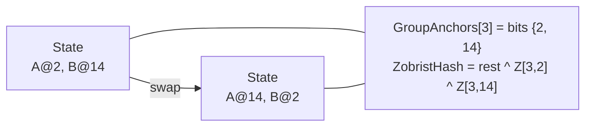

# 4. Zobrist hashing and GroupAnchors

## 4.1 Equivalence groups

Pieces with the same `BaseMask`, the same `AllowedDirections` and the same goal role are interchangeable. They share an
`EquivalenceGroupId` in `0..G-1`. In the 5x5 lab, the two 1x1 blocks A and B are both in group 3.

## 4.2 Zobrist keys indexed by group

The Zobrist table is indexed by **group**, not by piece: `ZobristTable[groupId, anchorSquare]`. It is filled deterministically from an
XorShift64* generator with a fixed seed, so hashes are reproducible between runs.

Moving any piece of group `g` from `oldAnchor` to `newAnchor` updates the hash in O(1):

```
Hash ^= ZobristTable[g, oldAnchor] ^ ZobristTable[g, newAnchor];
```

## 4.3 Lossless canonical state: `GroupAnchors[g]`

Alongside the hash, the state stores one bitboard per group: bit `s` of `GroupAnchors[g]` is `1` iff some piece of group `g` has its
anchor on square `s`. A move updates it with one XOR:

```
GroupAnchors[g] ^= (1UL << oldAnchor) | (1UL << newAnchor);
```

`PolyominoState.Equals` and `GetHashCode` use only `GroupAnchors` and `ZobristHash`. The per-piece anchor buffer exists purely so a UI
can remember which piece is which.

## 4.4 Why swapping identical pieces changes nothing

Let A be on square `a` and B on square `b`, both in group `g`. Swapping them XORs the same two keys, only in a different order:

```
before:  Hash = rest ^ Z[g,a] ^ Z[g,b]
after:   Hash = rest ^ Z[g,b] ^ Z[g,a]      (XOR is commutative and associative)
```

and `GroupAnchors[g]` has bits `a` and `b` set either way. So the state's identity, hash and canonical bitboards are identical with no
sorting. The `Swap Identical 1x1 Pieces` button in Lab 2 demonstrates this live, and
`SwappingIdenticalPiecesKeepsGroupAnchorsAndHash` in the tests asserts it.



The same idea is the reason `KlotskiState` equality uses only its canonical shape key: two positions that differ by swapping identical
blocks are the same node in the search graph. In classic Klotski this collapses the search space by up to a factor of 576.
