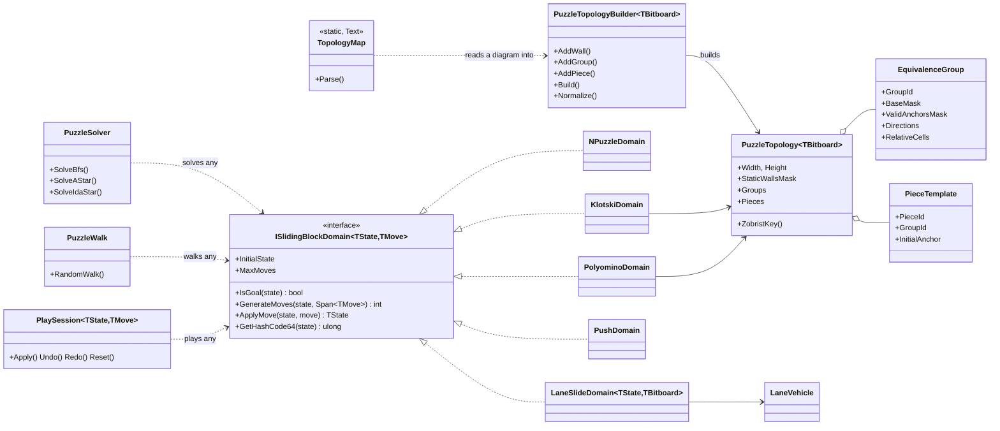
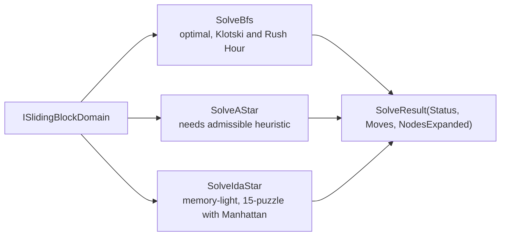
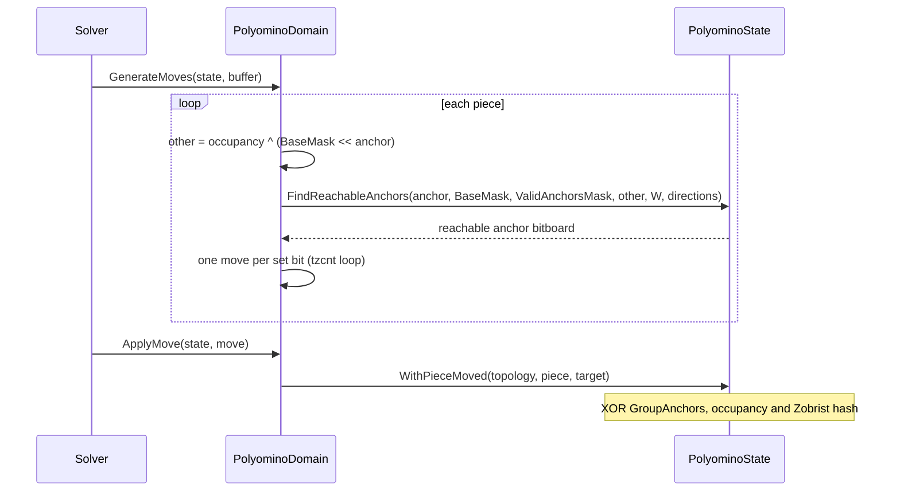

# 5. Object model

The model separates **immutable topology** (reference types built once per puzzle) from **value-type search states** (structs
implementing `IEquatable<TState>`). Move generation writes into caller-supplied `Span<TMove>` buffers, so hot paths allocate nothing.

## 5.1 Class overview

## 5.1a What the engine does not know

Goals are data. `NPuzzleDomain(initial, goal)`, `KlotskiDomain(topology, masterPieceId, goalAnchor)`, `LaneSlideDomain<TState, TBitboard>(vehicles, columns, rows, goalVehicle, goalOffset, maxStep)` (`LaneState16` or `LaneState64` for the position; `Bitboard64` for up to 64 cells, `Bitboard128` for up to 128; Rush Hour is `maxStep: 1` with the red car as the goal vehicle),
`PushDomain(columns, rows, floor, targets, cases, player)`
and `PolyominoDomain<TBitboard>(topology, goalGroupId, goalAnchor)` (or `PolyominoDomain(topology, goalPosition)` for a whole-position goal where identical pieces are interchangeable, optionally ignoring some groups; both build a `PolyominoGoal`, which `CompositeDomain` takes too) receive the answer from the puzzle that uses them. The engine has no layouts
(the classic Klotski map, the Rush Hour boards), no notion of where the blank belongs, no goal-relative heuristic baked into a state
(`NPuzzleDomain.ManhattanDistance` is measured against the goal it was given) and no colours. Layouts and goals live in the puzzle
definitions of the application that uses the engine (`LabPuzzles` in the Labs is one).

The `E2e4.SlidingBlock.Logic.Text` namespace reads diagrams (one string per row) into those data: `TopologyMap.Parse`, `LaneDiagram.Parse` and
`PushMap.Parse`. The symbols are parameters, so no map convention is built in, and the domains themselves never see a string.

## 5.2 Topology types

| Type | Role |
|------|------|
| `AllowedDirections` | `None`, `Horizontal`, `Vertical`, `Both` |
| `EquivalenceGroup` | Interchangeable pieces: LSB-normalised `BaseMask`, `ValidAnchorsMask`, directions, anchor-relative cells |
| `PieceTemplate` | One physical piece: id, group, label, initial anchor |
| `PuzzleTopology<TBitboard>` | Board size, wall mask, groups, pieces, one-way cells, partitions and plates (all read-only), and the Zobrist keys |
| `PuzzleTopologyBuilder<TBitboard>` | Builds a topology from relative cell lists; validates cells, anchors and overlaps; computes the masks |
| `LaneVehicle` | One vehicle of a lane-sliding puzzle: lane, length, breadth, start offset |

`TopologyMap.Parse` reads a diagram: by default `#` is a wall, `.` is empty and any other character is one piece; a legend maps characters to a
`PieceKind` (name, directions and an opaque key; appearance such as colour is the consumer's business).
Pieces whose normalised shape, directions and role match join the same group. `LaneDiagram.Parse` reads vehicles the same way, and `PushMap.Parse` a Soko warehouse.

## 5.3 State types

| State | Size | Fields |
|-------|------|--------|
| `NPuzzleState` (`readonly struct`) | 8 bytes | `PackedNibbles` |
| `LaneState16` / `LaneState64` (`readonly struct`) | 8 / 32 bytes | packed offsets, 4 bits per vehicle (16 / 64 vehicles) |
| `KlotskiState` (`readonly struct`) | | `[InlineArray(10)]` piece anchors, `OccupancyMask` (20 bits), `CanonicalShapeKey` (60 bits) |
| `PolyominoState` (`struct`) | | `[InlineArray(16)]` `GroupAnchors`, `[InlineArray(16)]` piece anchors, `OccupancyMask`, `ZobristHash` |

`[InlineArray]` gives fixed-size buffers inside the struct with no heap object. For `PolyominoState` and `KlotskiState`, equality
deliberately ignores the per-piece anchor buffer; see [section 4](04-zobrist-and-group-anchors.md).

## 5.4 Moves

| Domain | Move | Meaning |
|--------|------|---------|
| `NPuzzleDomain` | `NPuzzleMove(From, To)` | the tile on `From` slides into the blank on `To` |
| `KlotskiDomain` | `KlotskiMove(Piece, From, To)` | one-cell step of a piece (single-step metric) |
| `LaneSlideDomain<TState, TBitboard>` | `LaneMove(Vehicle, Offset)` | the vehicle slides to `Offset` along its lane, at most `maxStep` cells (1 for Rush Hour) |
| `PushDomain` | `PushMove(Case, To, PlayerAt)` | one case pushed to `To` in as many pushes as it takes; the storeman's walking is free |
| `ShuntingDomain<TBitboard>` | `ShuntingMove(Mover, Lead, FrontLength, RearLength, FrontChoices, RearChoices)` | one engine moves one slot, pushing the train ahead and pulling any rear prefix; a turntable turn is a move too; costs come from `IWeightedDomain` (see [shunting](shunting.md)) |
| `PolyominoDomain` | `PolyominoMove(PieceId, TargetAnchor)` | one turn, including multi-step hooks |

## 5.5 Solving

All three accept a `CancellationToken` (cancelling throws `OperationCanceledException`). `PuzzleSolver.MaxNodes` bounds the search, and a search that finds nothing returns
a result with no moves whose `Status` tells `Unsolvable` (the reachable positions ran out) from `NodeLimit` (the search stopped first); check `IsSolved`.
IDA* avoids immediately returning to the parent state by comparing states for equality, so it works with any domain.

## 5.6 Move generation in one picture (polyominoes)

