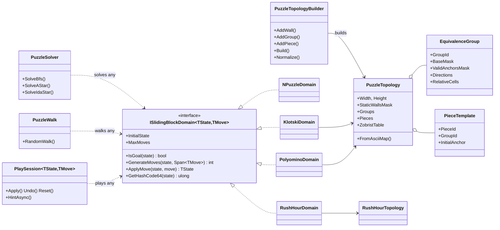
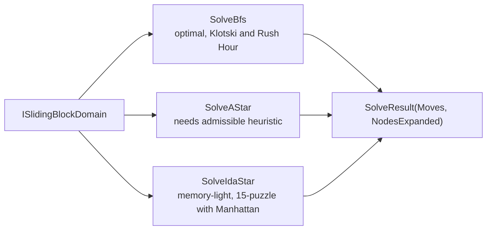
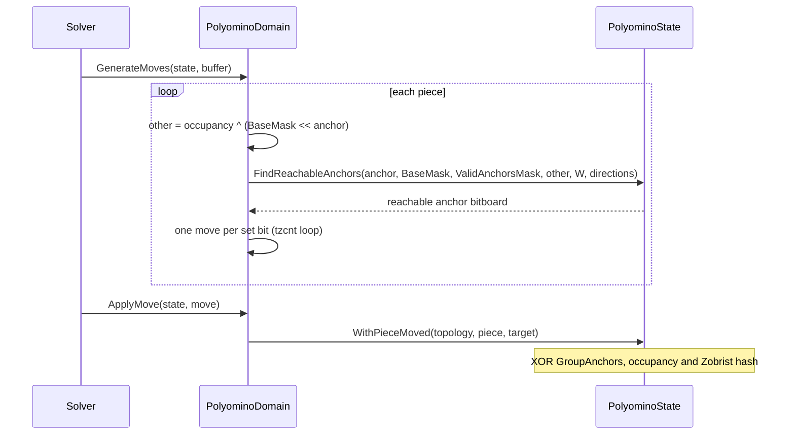

# 5. Object model

The model separates **immutable topology** (reference types built once per puzzle) from **value-type search states** (structs
implementing `IEquatable<TState>`). Move generation writes into caller-supplied `Span<TMove>` buffers, so hot paths allocate nothing.

## 5.1 Class overview

## 5.1a What the engine does not know

Goals are data. `NPuzzleDomain(initial, goal)`, `KlotskiDomain(topology, masterPieceId, goalAnchor)`, `RushHourDomain(topology, goalVehicle, goalOffset)`
and `PolyominoDomain(topology, goalGroupId, goalAnchor)` (or `PolyominoDomain(topology, goalPosition)` for a whole-position goal where identical pieces are interchangeable, optionally ignoring some groups) receive the answer from the puzzle that uses them. The engine has no layouts
(the classic Klotski map, the Rush Hour boards), no notion of where the blank belongs, no goal-relative heuristic baked into a state
(`NPuzzleDomain.ManhattanDistance` is measured against the goal it was given) and no colours. Layouts and goals live in the puzzle
definitions of the consumers (`E2e4.SlidingBlock.Puzzles.Core`; `LabPuzzles` in the Labs).

## 5.2 Topology types

| Type | Role |
|------|------|
| `AllowedDirections` | `None`, `Horizontal`, `Vertical`, `Both` |
| `EquivalenceGroup` | Interchangeable pieces: LSB-normalised `BaseMask`, `ValidAnchorsMask`, directions, anchor-relative cells |
| `PieceTemplate` | One physical piece: id, group, label, initial anchor |
| `PuzzleTopology` | Board size, wall mask, groups, pieces, Zobrist table; factory from an ASCII map |
| `PuzzleTopologyBuilder` | Builds a topology from relative cell lists; validates anchors and overlaps; computes the masks |
| `RushHourTopology` | Vehicles plus `VehicleMasks`, `FrontNeighborBit`, `BackNeighborBit` |

ASCII maps use `#` for a wall, `.` for empty, and any other character for one piece; a legend maps characters to a `PieceKind` (name, directions and an opaque key; appearance such as colour is the consumer's business).
Pieces whose normalised shape, directions and role match join the same group.

## 5.3 State types

| State | Size | Fields |
|-------|------|--------|
| `NPuzzleState` (`readonly struct`) | 8 bytes | `PackedNibbles` |
| `RushHourState` (`readonly struct`) | 8 bytes | `PackedOffsets` (3 bits per vehicle) |
| `KlotskiState` (`readonly struct`) | | `[InlineArray(10)]` piece anchors, `OccupancyMask` (20 bits), `CanonicalShapeKey` (60 bits) |
| `PolyominoState` (`struct`) | | `[InlineArray(16)]` `GroupAnchors`, `[InlineArray(16)]` piece anchors, `OccupancyMask`, `ZobristHash` |

`[InlineArray]` gives fixed-size buffers inside the struct with no heap object. For `PolyominoState` and `KlotskiState`, equality
deliberately ignores the per-piece anchor buffer; see [section 4](04-zobrist-and-group-anchors.md).

## 5.4 Moves

| Domain | Move | Meaning |
|--------|------|---------|
| `NPuzzleDomain` | `NPuzzleMove(From, To)` | the tile on `From` slides into the blank on `To` |
| `KlotskiDomain` | `KlotskiMove(Piece, From, To)` | one-cell step of a piece (single-step metric) |
| `RushHourDomain` | `RushHourMove(Vehicle, Delta)` | one-cell step, `Delta` is `-1` or `+1` |
| `PolyominoDomain` | `PolyominoMove(PieceId, TargetAnchor)` | one turn, including multi-step hooks |

## 5.5 Solving

All three accept a `CancellationToken`; `PuzzleSolver.MaxNodes` bounds the search and returns `null` when it is hit. IDA* avoids
immediately returning to the parent state by comparing states for equality, so it works with any domain.

## 5.6 Move generation in one picture (polyominoes)

